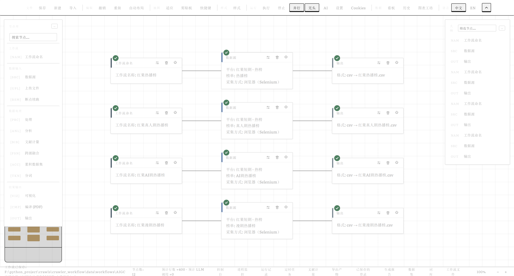
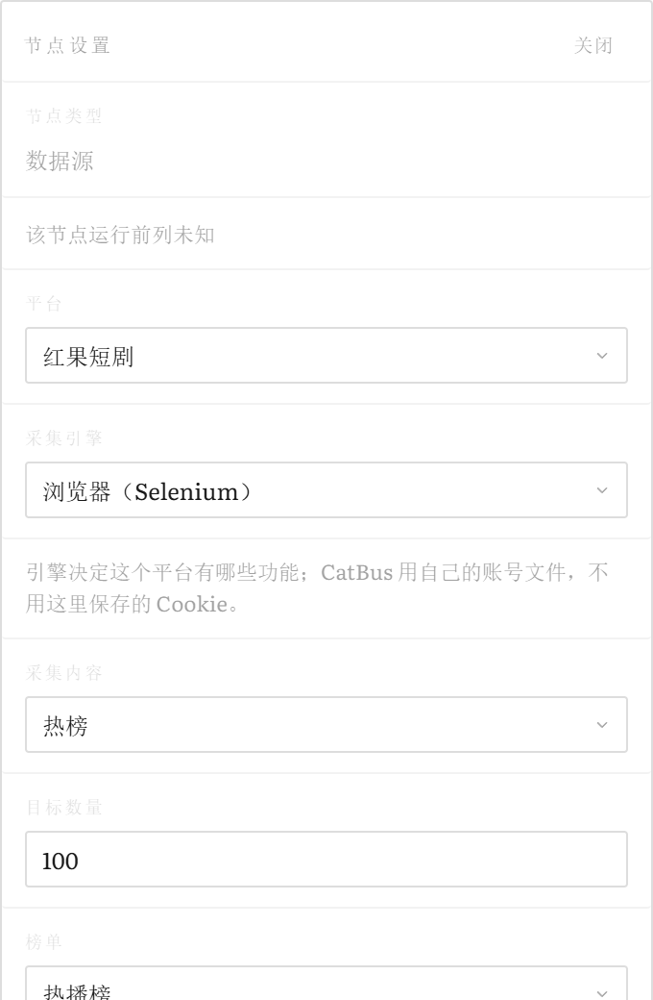
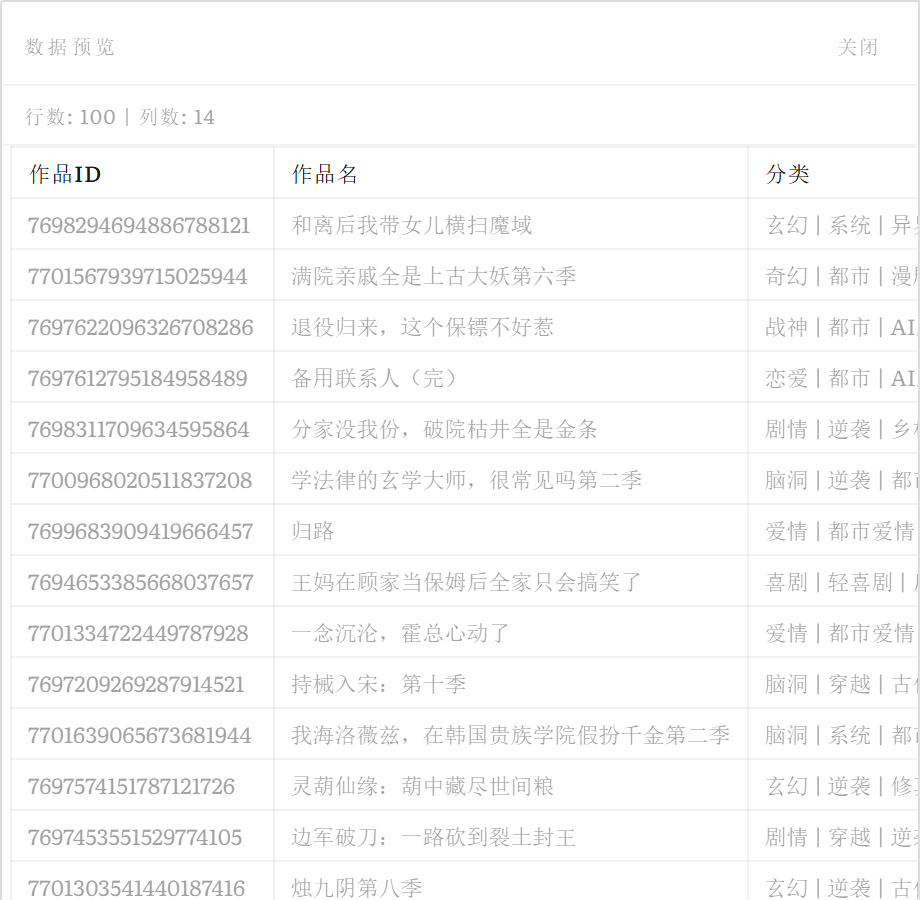
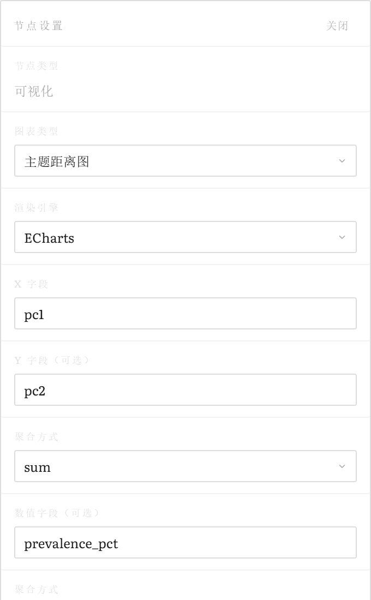
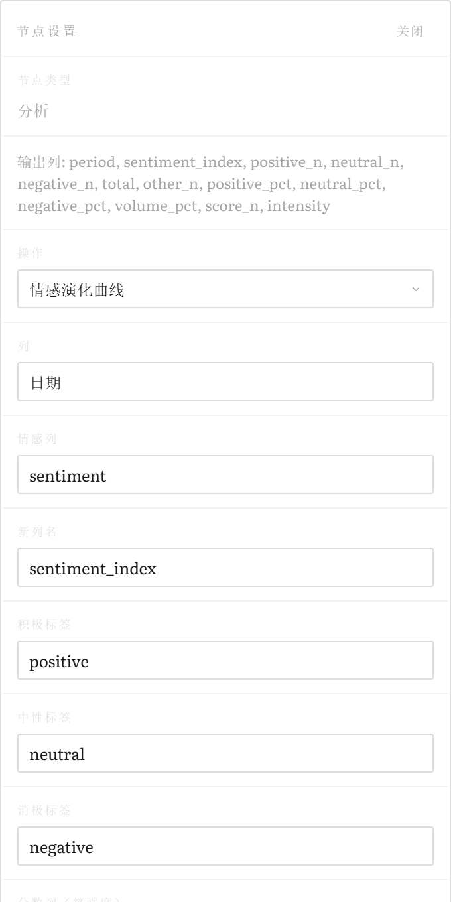
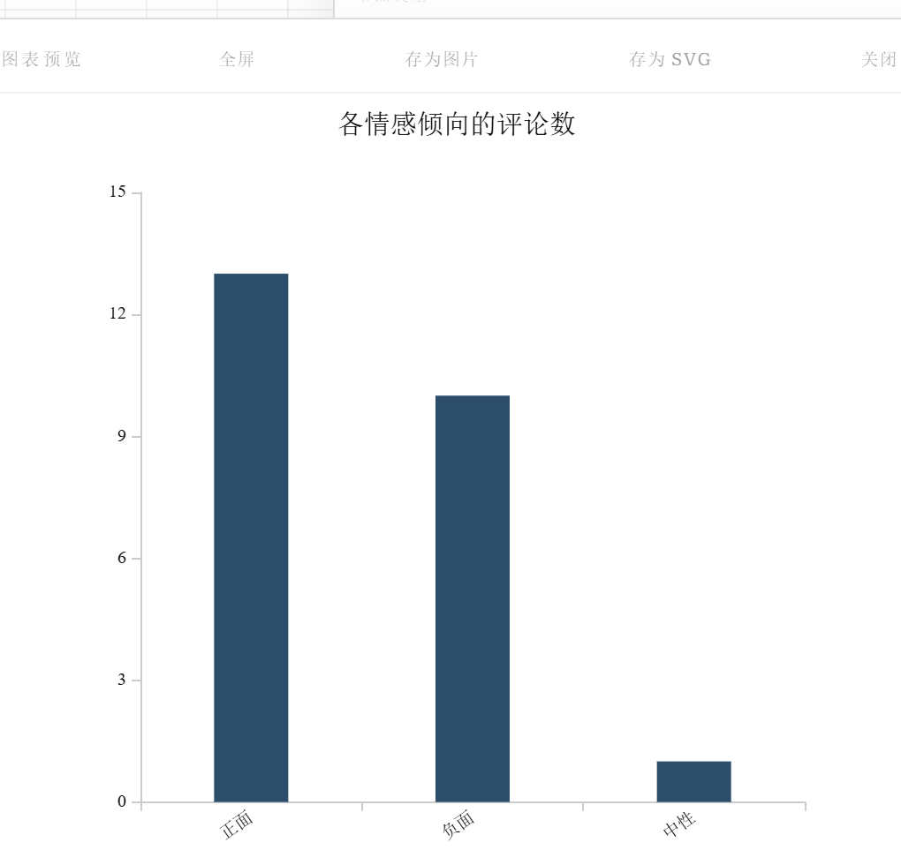
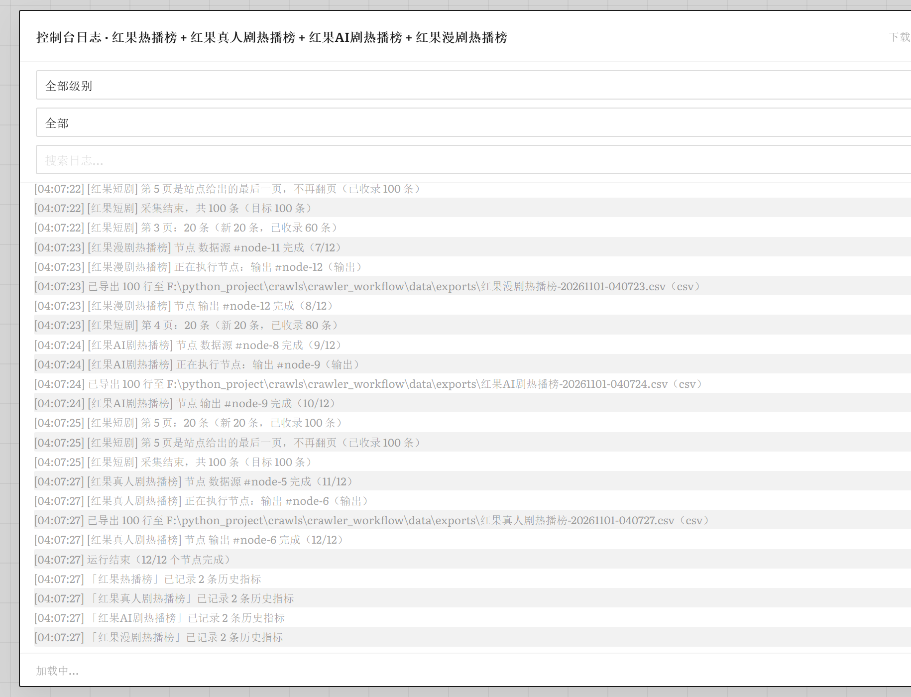

# 采析绘

**把“采集 → 清洗 → 分析 → 可视化”画成一条能跑的工作流。** Flask + Selenium + 本地/在线大模型 +
scikit-learn，拖节点、连线条、点执行；中断了能从断点接着跑，已经花掉的采集与模型费用不用再付一遍。

> 这里只讲怎么用起来。分平台细节、分析方法、引擎与 API 都在 [`docs/`](docs/)（见文末索引），
> 给 AI agent 的改动规则在 [`AGENTS.md`](AGENTS.md)。

**在线体验**：<http://47.116.114.77/crawler>（云端模式，登录后使用）　·　**不想装 Python**：
[Releases](https://github.com/Xingye-Dujing/crawler-workflow/releases) 有 Windows 安装包 `CaiXiHui-Setup.exe`
和手册 PDF。



一条跑过的红果短剧工作流：左边是节点库，中间是画布，右边是大纲；节点左端的色条是类型，右上角的绿勾是上次运行的
结论。界面六块区域各自管什么、每块怎么用，见[图文手册](docs/manual/)。

## 快速开始

源码版 Windows / Linux / macOS 都能跑（云端部署目标是 Linux）。只有两处是 Windows 专属：`desktop/`
打包，以及红果短剧的评论收割（要驱动本机播放器并装系统证书）——后者在其他系统上按名拒绝，面板也不给这个选项。

**你需要什么**

- Python 3.11（代码用了 `zip(..., strict=True)`），依赖装在项目自己的 `.venv/` 里，不要用系统 Python。
- Chrome 和**与它大版本匹配的 chromedriver**。源码/便携版按当前系统自己找，也认 `CHROME_PATH`/`CHROME_BIN`
  与 `CIXI_DRIVER_PATH`（设置面板里也能填）；在线安装版默认只用安装器装的那一份，缺了按名报“安装器未安装”，
  只有切到“本机已安装的”才查本机。版本不匹配会按名拒绝，不会偷偷下载一个驱动顶上。
- 模型二选一：[Ollama](https://ollama.ai/) 本地跑，或 OpenRouter 的 API Key。只做清洗/统计不动模型也能用。
- 可选：`xelatex` 只给“编译 PDF / 论文成稿”，中文字体（Linux 装 `fonts-noto-cjk`）只给中文图表；
  缺了会告诉你缺什么，不会画一屏方框。

**跑起来**

```bash
cd crawler_workflow
python -m venv .venv
source .venv/bin/activate          # Windows: .venv\Scripts\activate
pip install -r requirements.txt
ollama pull qwen3.5:9b             # 可选，用 OpenRouter 可跳过

cd backend && python app.py        # http://127.0.0.1:5000
```

`backend/` 是 `sys.path` 根，必须从那里启动。端口用 `PORT`、监听地址用 `HOST`；开发时
`FLASK_DEBUG=1` 开热重载。

不想在本机装：直接开 <http://47.116.114.77/crawler> 用线上实例（云端模式，需要账号），或者下
[Releases](https://github.com/Xingye-Dujing/crawler-workflow/releases) 里的 `CaiXiHui-Setup.exe`；
只想要一个下载器就用 `CaiXiHui-Online-Setup.exe`，默认走国内镜像（Gitee / npmmirror），不需要翻墙。
macOS 下载 `CaiXiHui-macOS-<arch>.dmg`（arm64 / x86_64），或用小体积的
`CaiXiHui-Online-Setup-macOS-<arch>.dmg` 在线安装。

**三件值得先知道的事**

- **一个数据根只开一个服务。** 状态都在同一份 `data/`（运行、数据集、Cookie、导出），第二个实例会把正在
  写的那次判成中断。确实需要（跑验证脚本、开测试服务）时给它一份自己的目录：
  `CRAWLER_DATA_ROOT=<目录>`，两份互不干扰。
- **给别人用就开云端模式**：`python app.py cloud`（或 `CRAWLER_CLOUD=1`）。关掉本地模型、强制无头、
  强制多账号登录——首次启动必须给 `CRAWLER_ADMIN_PASSWORD` 和 `SECRET_KEY`，否则拒绝启动。每个账号的
  工作流、数据集、运行、Cookie、导出都在 `data/users/<账号 id>/` 下，互相看不见。旧数据用
  `tools/migrate_accounts.py` 迁到管理员名下（默认 dry-run，先备份）。
- **不想装 Python 就用桌面版（Windows / macOS）**：[Releases](https://github.com/Xingye-Dujing/crawler-workflow/releases)
  里有现成的 `CaiXiHui-Setup.exe`；只想要小体积下载器就用 `CaiXiHui-Online-Setup.exe`，默认从 Gitee /
  npmmirror 下载主程序、Chrome、chromedriver、Node 和 CatBus，国内不需要翻墙（见
  [`docs/installer.md`](docs/installer.md)；以后的功能更新与发版步骤见
  [`docs/release.md`](docs/release.md)）。安装器和主程序都是**原生窗口**（Windows 自带的
  Microsoft Edge WebView2；macOS 用系统 WebKit），没有控制台、也不开浏览器；**主程序首次启动默认浅色**
  （设置里仍可切自动/深色），**启动即最大化**；安装器是一屏窗口。**关闭主窗口即退出整个程序**，
  **最小化则继续在后台采集/跑定时任务**。
  程序和用户数据都能选在 C 盘以外（“数据文件夹”写进 `app\data-root.txt`）。`desktop/` 负责打出
  `CaiXiHui.exe`，双击启动本地服务并在窗口里显示界面，数据默认在 `%APPDATA%\CaiXiHui`（旁边放个空的
  `portable.txt` 就变便携版）。macOS 的 `.app`/DMG 由 `desktop/build_macos.py` 在 GitHub 的 macOS runner
  上构建并发布（`.github/workflows/macos-build.yml`），数据在 `~/Library/Application Support/CaiXiHui`；
  主程序启动后会检查 `version.json`，有新版本时在顶部提示并可在应用内完成下载、校验、替换和重启；
  组件目录和用户数据不会被更新碰。源码运行不执行自更新。
  同一个 workflow 还产出小体积的 `CaiXiHui-Online-Setup-macOS-<arch>.dmg`（先下载主程序 DMG 和
  Chrome/Node，再装到 `/Applications`）；CatBus 现在也有 macOS 官方构建，安装器会像 Windows 一样下载并
  连同 Node 一起装好。
  Windows 与 macOS 的在线安装器都能选一个本地的 `CaiXiHui-bert-models-win64.zip`（ONNX 模型两个平台
  通用；这是只读源），解压到数据文件夹的 `bert_models/`（存放位置随数据文件夹同步）并登记进模型列表。
  构建、体积与依赖自查见 [`desktop/README.md`](desktop/README.md)。

## 能做什么

- **采集**：知乎、微博、小红书、微信公众号、哔哩哔哩、抖音、红果短剧、中国知网、YouTube、X（Instagram
  目前只能存 Cookie）。关键词、作者作品、热榜、评论四种玩法，支持流式落库、上游表格喂链接、多账号与持久
  Profile——红果短剧例外，它的版面全匿名，不建持久 Profile。红果**评论**要驱动本机播放器旁听，仅 Windows，
  其他平台会置灰并写明原因。→ [`docs/collection.md`](docs/collection.md)
- **第二采集引擎 CatBus**：按“平台 × 引擎 × 功能”列出能采什么、出哪些列；能力全部读适配器自己的清单，
  不可运行的组合直接写清原因，绝不静默换后端或降级成空表。→ [`docs/collection.md`](docs/collection.md)
- **分析**：情感、倾向、情绪（LLM / sklearn / 微调 BERT，默认 BERT，跑不动会降级并打印实际用的方法）、
  NER、关键词、聚类、异常、相关性、显著性检验、网暴言论识别。→ [`docs/analysis.md`](docs/analysis.md)、
  [`docs/why_finetuned_bert.md`](docs/why_finetuned_bert.md)
- **处理**：确定性清洗、去重（含 SimHash 近似重复）、分组聚合、事件研究套件（阶段划分、分阶段 LDA、主题
  流向、情感演化、二次爆发预警），以及 CSV/JSON/Excel/TXT/HTML/Markdown 导出。→ [`docs/analysis.md`](docs/analysis.md)
- **文献计量**：上传就自动识别 CNKI/CSSCI/WoS/Scopus/PubMed/RIS/BibTeX 等导出件，按时间切片建关键词、
  作者、机构、共被引网络，输出 GraphML/GML/Pajek 等；顶栏的文献计量工作区能存快照、和上次比。→ [`docs/analysis.md`](docs/analysis.md)
- **可视化与成稿**：ECharts 与 Matplotlib 双引擎的论文风格图表、知识图谱与各类叠加图、LaTeX 图与三线表；
  “论文成稿”只给 `run_id` 就能把登记过的图与表合成 `ctex` 文档并本机编译。→ [`docs/analysis.md`](docs/analysis.md)
- **画布与运行**：拖拽、fan-in/fan-out、撤销重做、大纲定位、自动排布、运行队列与停止；14 种节点；画布快照
  与可复用节点模板；节点级检查点与运行记录，默认载入本工作流最近一次结果，绿勾/转圈/红叉一眼看清上次到哪。
  → [`docs/workflow.md`](docs/workflow.md)
- **数据集与定时**：累积数据集带版本与去重策略，可多源合并同构数据集；定时任务用预设或 cron 跑已存画布
  （含模型节点的画布会标明不能定时），停机错过的时刻只记“已错过”，不补跑。→ [`docs/workflow.md`](docs/workflow.md)
- **界面**：中英双语、亮暗主题、快捷键与框选、运行前诊断（每个节点常驻校验角标）。→ [`docs/workflow.md`](docs/workflow.md)

### 看界面

下面几张图都是从[图文手册](docs/manual/)里取的，按界面现在的样子拍：

| 数据源面板 | 数据预览 |
|:--:|:--:|
|  |  |
| 平台、采集引擎、内容、数量、分片、格式一行一行往下排；需要先选一项的字段不替你猜默认值 | 采完不用导出就能翻，顶上是行数与列数，一页一页往下看 |

分析节点也一样，参数就是这一步的口径，选错按名拒绝：

| 主题距离图（LDA + 句向量） | 情感演化曲线 |
|:--:|:--:|
|  |  |
| 一行一个主题，出 `topic/pc1/pc2/prevalence_pct` 再交给可视化画气泡 | 按日聚合成指数，接“情感演化”可视化节点出曲线与阶段 |

出图与运行：

| 图表预览 | 控制台日志 |
|:--:|:--:|
|  |  |
| ECharts 与 Matplotlib 两套引擎，出图即可复制 LaTeX 图源与三线表 | 实时日志按工作流分页签，同一份同时写进运行库，事后还能翻到 |

## 项目结构

```
crawler_workflow/
├── backend/          # Flask 组合根 + core/runtime/api/engine/nodes/analyzers/crawlers/services/static
├── data/             # 运行时数据（gitignore；只有 workflows/ 进版本库）
├── docs/             # 文档与实测记录
├── tests/            # unit / api / integration / frontend / 真站
├── ml_train/         # 训练脚本与模型（gitignore）
├── desktop/          # Windows 打包（唯一故意只服务 Windows 的目录）
└── requirements.txt  # 可选依赖在 requirements-optional.txt
```

逐模块的目录树在 [`docs/development.md`](docs/development.md)，代码地图在 [`docs/ARCHITECTURE.md`](docs/ARCHITECTURE.md)。

## 三种常见用法

**从零跑一条**：拖 Data Source 选平台和关键词 → Process 选清洗/情感 → 可选 Analysis 出词频或主题 →
Visualize 出图、Output 导出 → 连线、用 Name 命名 → 执行。

**只分析已有表**：拖 Upload 上传 CSV/TSV/JSON/Excel 或文献导出件，接 Analysis/Visualize/Bibliometrics；
也可以从“已保存数据集”里挂载，或者直接拿上游节点的表格喂给下游。

**中断了怎么办**：Stop、关服务、中途失败都不要紧，已完成的节点和处理过的行都在 `data/runs.db`。重开后顶部
会出现“检测到中断的运行”，点“继续”只补缺的部分（模型走缓存不重复付费），点“重新开始”则全量重跑。

## 文档

| 文件 | 里面是什么 |
|---|---|
| [`docs/manual/`](docs/manual/) | 图文手册：从零到成稿，含七个真实工作流 |
| [Releases](https://github.com/Xingye-Dujing/crawler-workflow/releases) | 手册 PDF（`CaiXiHui-Manual-*.pdf`）与 Windows 安装包（`CaiXiHui-Setup.exe` / 免装 zip） |
| [`docs/ARCHITECTURE.md`](docs/ARCHITECTURE.md) | 代码结构地图与模块接缝 |
| [`docs/collection.md`](docs/collection.md) | 各平台采什么、出哪些列、有哪些选项 |
| [`docs/analysis.md`](docs/analysis.md) | 分析、处理、可视化、文献计量的细节 |
| [`docs/workflow.md`](docs/workflow.md) | 引擎、断点续跑、界面、节点类型、定时任务 |
| [`docs/api.md`](docs/api.md) | 全部 HTTP 端点 |
| [`docs/config.md`](docs/config.md) | 环境变量、运行时设置、常量、云端部署 |
| [`docs/installer.md`](docs/installer.md) | 在线安装器、国内直连镜像、环境检测与组件管理 |
| [`docs/development.md`](docs/development.md) | 完整结构、测试分层、备份与恢复 |
| [`docs/crawler_notes.md`](docs/crawler_notes.md) | 逐平台真机实测记录（改爬虫前先看） |
| [`docs/crawler_rules.md`](docs/crawler_rules.md) | 采集端工程规则 |
| [`docs/live_test_plan.md`](docs/live_test_plan.md) | 全平台真机验收矩阵 |
| [`docs/frontend_modules.md`](docs/frontend_modules.md) | 前端拆分方案 |
| [`docs/tendency_model_comparison.md`](docs/tendency_model_comparison.md) | 倾向性模型对比研究 |
| [`AGENTS.md`](AGENTS.md) | 面向 AI agent 的规则与改动流程 |

## 许可与备份

MIT，见 [`LICENSE`](LICENSE)。`data/` 不进 git（`data/workflows/` 例外），所以还需要还原点：
`tools/backup.py` 生成 git bundle 加数据归档（含每个账号的库与工作流，默认不含 Cookie），
用法见 [`docs/development.md`](docs/development.md)。
