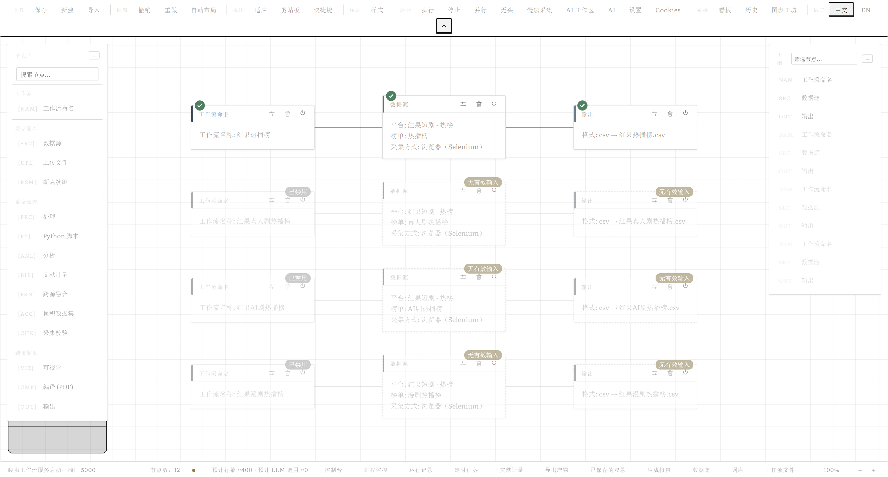
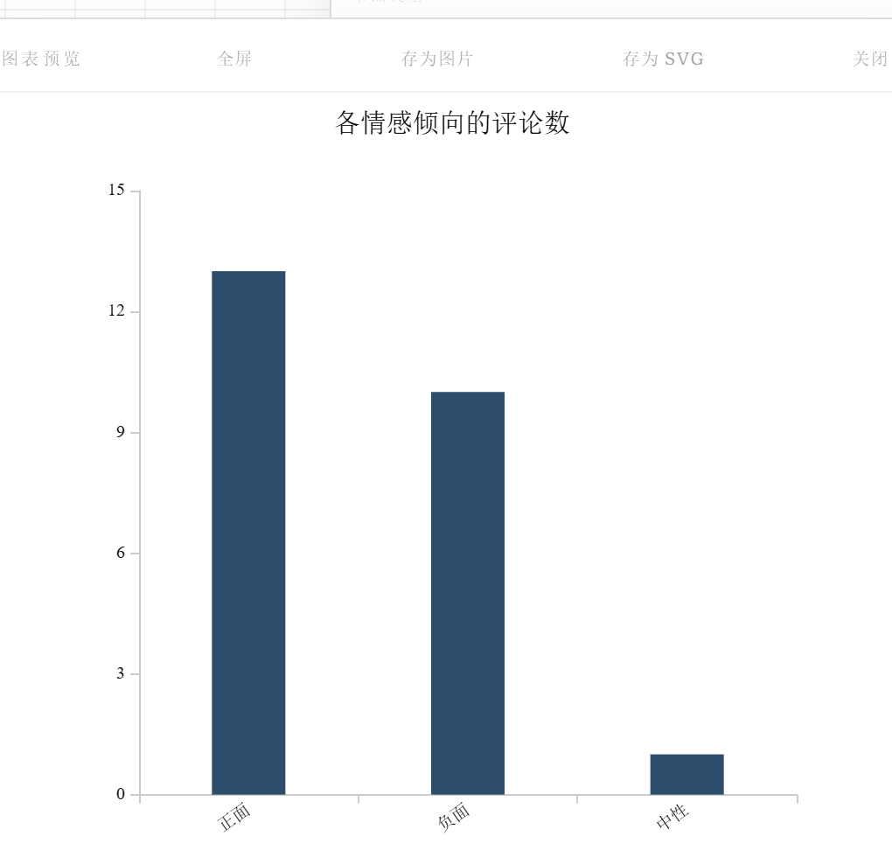
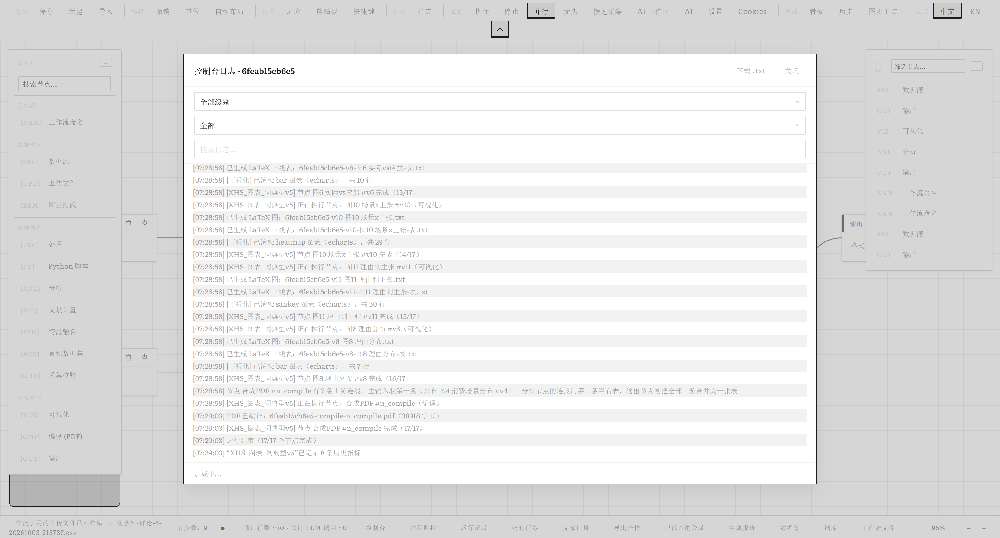

# 采析绘

**把“采集 → 清洗 → 分析 → 可视化 → 成稿”画成一条能跑的工作流。** Flask + Selenium + CatBus + 本地/在线大模型 +
scikit-learn；拖节点、连线条、点执行，中断后从断点续跑，已花掉的采集与模型费用不再付第二遍。

**在线体验**：<http://47.116.114.77/crawler>（云端模式，需登录）　·　**不装 Python**：
[Releases](https://github.com/Xingye-Dujing/crawler-workflow/releases) 提供 Windows 安装包、macOS DMG 与手册 PDF。



使用说明见[图文手册](docs/manual/)，工程细节见[文档索引](#文档)，AI agent 的改动规则见 [`AGENTS.md`](AGENTS.md)。

## 快速开始

源码版 Windows / Linux / macOS 均可运行（云端部署目标是 Linux）。

| 需要 | 说明 |
|---|---|
| Python 3.11 | 依赖装在项目自己的 `.venv/`，不要用系统 Python |
| Chrome + 匹配的 chromedriver | 按当前系统自动查找，也认 `CHROME_PATH`/`CHROME_BIN`、`CIXI_DRIVER_PATH`；版本不匹配按名拒绝，不偷偷下载驱动 |
| 模型（可选） | 本地 [Ollama](https://ollama.ai/) 或 OpenRouter API Key；只做清洗/统计可不用模型 |
| 可选组件 | `xelatex` 仅用于“编译 PDF / 论文成稿”，中文字体（Linux `fonts-noto-cjk`）仅用于中文图表；缺了会报缺什么 |

```bash
python -m venv .venv && . .venv/bin/activate     # Windows: .venv\Scripts\activate
pip install -r requirements.txt
ollama pull qwen3.5:9b                            # 可选
cd backend && python app.py                       # http://127.0.0.1:5000
```

`backend/` 是 `sys.path` 根，必须从那里启动。端口用 `PORT`，监听地址用 `HOST`，开发时 `FLASK_DEBUG=1` 开热重载。

## 采集

| 平台（9 个社交平台 + 知网） | 玩法 |
|---|---|
| 知乎、微博、小红书、微信公众号、哔哩哔哩、抖音、YouTube、X | 关键词、作者作品、热榜、评论 |
| 红果短剧 | 关键词与评论；评论需驱动本机播放器，仅 Windows，其他系统按名拒绝并隐藏该选项 |
| 中国知网 | 文献导出件识别（上传后自动解析） |
| Instagram | 仅 Cookie 保存，不采集 |

- 流式落库、上游表格喂链接、多账号与持久 Profile。**评论采到 0 行不等于没有评论**：风控/登录墙/未渲染/中途停止都把游标钉在那一条，节点按失败或部分收尾，`继续` 从洞口重采；只有站点给出结束标记或命中评论上限才算采完。
- **爬楼中楼**：知乎、微博、小红书、哔哩哔哩、抖音的评论表单有“爬楼中楼（子回复）”复选框，默认开启；关闭后只采主评论，父评论行的“子回复数”仍显示站点自己的计数。红果短剧的同名开关在它的评论表单里。

- **第二采集后端 CatBus**：按“平台 × 引擎 × 功能”列出能力与列，全部读适配器清单；11 个平台的全部只读表格能力（含未读通知数、购物车商品数、订单列表、商品优惠券、直播弹幕记录、视频字幕、专栏草稿）都自动成为采集模式，不可运行的组合写清原因，绝不静默换后端或降级成空表。登录用适配器自己的账号，运行前必问一次。
- **AI 工作区可驱动 catbus**：要采集数据时先问“建画布节点（第二后端选 catbus）”还是“AI 直接调 catbus 指令运行”，回答前用只读的 `catbus_status` 探测本机 Node/适配器与全局 CLI，有就不新装、缺啥点名啥；云端按名拒绝。权威技能文档随仓库放在 [`docs/catbus/`](docs/catbus/SKILL.md)。
- 细节与列约定： [`docs/collection.md`](docs/collection.md)、[`docs/crawler_rules.md`](docs/crawler_rules.md)。

## 处理与分析

- **清洗与整理**：确定性清洗、去重（含 SimHash 近似重复）、分组聚合、反向筛选（两表比一列找差集/重复）、采集校验（清单表 vs 评论结果表，报出没采到与条数不足的链接）。
- **口径即答案**：列重命名撞上已有列名、类型转换做不成（如 `1.5` 转整数）、阶段分组没有可用顺序——都按名拒绝或点名，不留一张看着完整、实际被截断的表。分组聚合会自动沿用“分阶段”写出的阶段序号列；回复传播图按（文章、楼层）连接，多链接评论表不会把 A 文的回复连到 B 文的人。
- **分析**：情感、倾向、情绪（BERT 默认，跑不动会降级并打印实际方法）、NER、关键词、聚类、异常、相关性、显著性检验、网暴言论识别、分阶段 LDA、主题流向、情感演化、二次爆发预警；另有**语义近重复去重**与**相似文本检索**（小中文向量模型）。
- **本地模型目录**：模型清单、实测指标、下载与单任务训练、备份与数据集分类见 [`docs/models.md`](docs/models.md)；微调权重先备份到 `ml_train/backups/models/`，所有下载与缓存只在项目目录内。
- **文献计量**：CNKI/CSSCI/WoS/Scopus/PubMed/RIS/BibTeX 导出件，按时间切片建关键词、作者、机构、共被引网络，输出 GraphML/GML/Pajek，可存快照并与上次对比。
- **导出**：CSV / JSON / Excel / TXT / HTML / Markdown。
- 细节： [`docs/analysis.md`](docs/analysis.md)、[`docs/why_finetuned_bert.md`](docs/why_finetuned_bert.md)。

## 可视化与成稿

ECharts 与 Matplotlib 双引擎的论文风格图表、知识图谱与叠加图、LaTeX 图与三线表；“论文成稿”给一个 `run_id`
就能把登记过的图表合成 `ctex` 文档并在本机编译。步骤参数即口径，缺列或选错按名拒绝，不出空图。运行结束还能出
一份自带内容的 HTML 报告。

| 图表预览 | 控制台日志 |
|:--:|:--:|
|  |  |

## 画布与运行

- 16 种节点；拖拽、fan-in/fan-out、撤销重做、大纲定位、自动排布、画布快照与可复用节点模板。
- **工作流文件保存方式可设**：默认“一修改就保存”（改动后几秒静默写回打开的文件），“手动保存”只在点“保存”时写文件——此时刷新/重启保留未保存的画布草稿，不会被磁盘上的旧版本覆盖。**新建画布取了一个已存在的名字时会先问一句再覆盖**（已打开的文件照旧直接写回）。设置页 → 运行与节点默认值 → 工作流文件保存方式。
- **一个数据根同时只跑一个运行，忙时排队而不是拒绝**；停止、失败、关服务后已完成的节点与行都在 `data/runs.db`，重开顶部给出“检测到中断的运行”，`继续` 只补缺口（模型走缓存），`重新开始` 则全量重跑。中断的记录不会被“按天清理”删掉（它是继续要用的游标），只有已结束的旧记录才会过期；从重启里恢复的记录也会写上结束时间。
- 节点级检查点与运行记录，默认载入本工作流最近一次结果，绿勾/转圈/红叉一眼看清上次到哪；控制台按工作流分页签并持久化每次运行的日志。
- **数据集**：累积数据集带版本与去重策略，可多源合并同构数据集。
- **定时任务**：预设或 cron 跑已存画布；需要模型的画布会标明不能定时，停机错过的时刻只记“已错过”，不补跑。
- **界面**：中英双语、亮暗主题、快捷键与框选、节点常驻校验角标。
- 细节： [`docs/workflow.md`](docs/workflow.md)。

## 常见用法

| 场景 | 怎么做 |
|---|---|
| 从零跑一条 | Data Source 选平台与关键词 → Process 清洗/情感 → 可选 Analysis 出词频或主题 → Visualize 出图、Output 导出 → 连线、用 Name 命名 → 执行 |
| 只分析已有表 | Upload 传 CSV/TSV/JSON/Excel 或文献导出件，接 Analysis/Visualize/Bibliometrics；也可挂载已保存数据集，或把上游表格直接喂给下游 |
| 中断后接着跑 | Stop、关服务、失败都不影响已完成的节点与行；重开后顶部提示“检测到中断的运行”，`继续` 补缺口（模型走缓存），`重新开始` 全量重跑 |

## 账号、Cookie 与池

- 一个平台可保存多份登录，一份账号 = 一份 Cookie 文件 + 一个 Chrome Profile；运行前按需预检，登录墙拒绝运行，“无法核对”不阻塞。
- 连续 5 次密码错误锁 15 分钟（管理员可解除）；**锁定期内再猜也不会把期限往后推**，所以别人无法靠“每小时猜一次”把你永久锁在外面。
- **账号池（自动轮换）**：账号或出口被登录墙/风控拦下即冷却（默认 2 小时，网络问题只冷却出口 5 分钟），下次跳过换下一组；冷却持久化在 `data/pool.db`，面板可解冻、停用、手动绑定出口。**只在“这次一条都没采到”时换号**——已经采到行的链接按“部分完成、可继续”收尾，换号不会把读到的数据丢掉，也不会白占一个账号的冷却。
- **出口池**：Chrome 代理（HTTP/HTTPS/SOCKS5，可带认证，凭据只走本地回环中继）；出口与账号粘性绑定，坏了才换 IP，登录不变。允许直连时，出口全被冷却会按直连跑，而不是“面板说能跑、运行时按名拒绝”。
- 规则与归因： [`docs/account_pool.md`](docs/account_pool.md)、[`docs/crawler_rules.md`](docs/crawler_rules.md)。

## AI 工作区

- 顶栏 **AI 工作区** 打开右侧常驻面板：会话、对话、智能体轨迹、上下文检查器；顶栏 **AI** 子菜单负责逐行分析的模型/密钥/测试。
- **节点运行的可见追踪**：设置 → AI 工作区 → 模型调用追踪等级，按三档控制哪些节点运行时自动拉起会话——① 传统模型（本地 BERT/sklearn/SnowNLP/NLI/句向量，默认）、② LLM（本地 Ollama 与质性/内容编码）、③ API 调用（云端 DeepSeek/OpenRouter）；所选档位含更高档，`off` 关闭。LLM 节点逐 token 显示提示与回答，传统模型显示有界的输入/输出样本；会话底部标出真正运行的模型（如 `local BERT / …rbt3`），不会误显示成上次聊天的 LLM。
- **供应商**：DeepSeek 直连（原生 Chat Completions：深度思考、联网搜索、读链接、文件上传、安全审核）、OpenCode Go、OpenRouter、本地 Ollama。Key 只在本浏览器 `localStorage`，服务端仅在一次请求内持有（拉模型列表也走请求头，不进 URL），不写入 `data/` 或日志；云端模式按名拒绝本地 Ollama。
- **省 token 与 @ 引用**：输入框里打 `@` 可以直接引用本账号的**数据集、导出产物、工作流文件**和**之前上传过的文件**——数据集只读前几行，导出/工作流只展开有界摘要，之前上传的文件复用同一个 `file_id`（同一份文件在不同会话上传不会重复解析计费）。上传大表格（≥128 KB 或 200 行以上）会自动登记为数据集并给你一个 `@` 引用，单个附件超过 4 MB 按名字拒绝并说明改走数据集。
- **桌面版与网页版是同一个工作区**：会话、文件上传、联网搜索/抓页、技能、插件、运行监控、Python 扩展两端都有；差别只在宿主能触达的东西（本机模型/文件/代码插件/只读源码快照/Python），由服务端判定并在面板里按名说明，前端不猜。
- **记忆与会话**：AI 工作区有一份**你确认过**的长期记忆（工作室“记忆”页）：助手只能提出“记住这条”的产物卡，点应用才写入，随时可删；每条都会随之后每一轮上下文发送（最多 20 条进提示词，超出的数量在上下文检查器里写明，不会静默丢弃）。会话列表可按标题**服务端搜索**、置顶、归档/恢复，并下载为 Markdown 或 JSON；文件可多选、拖入或粘贴截图，三条入口走同一条上传路径。
- **运行监控**：AI 提出监控条件（节点失败、输出达到 N 行、控制台出现某句话、运行结束），你选“自动分析”或“只通知”；触发事件进入会话，自动分析用浏览器里的 Key，不花服务端的钱。**失败节点可直接重跑**：自动分析的回答里会列出失败节点（节点 id + 错误），点“重跑此节点及其下游”只重跑那一段；它读的是**已保存的工作流文件**（必须仍与运行记录一致），不会把旧画布载回你的画布。文件缺失、画布改过、节点不存在或运行仍在进行，都按名拒绝并说明原因。侧栏还可“新建监控”手动填规则：可选事件名由服务端从匹配表提供（`GET /api/ai/monitors/catalog`），前端不持第二份表，并与产物卡共用同一条布防端点。
- **跨面板入口**：数据集列表、运行列表和节点设置里都有“问 AI”：点一下打开工作区、新建会话、把这个对象作为上下文引用，并把问题**预填在输入框里（不自动发送）**——你改完再按发送。
- **逐次审批**（审批卡显示确切改动：写文件给出解析后的路径与逐行 diff，命令给出命令/工作目录/超时，重跑给出运行/节点/工作流；预览只读、不会真的写入）：关闭“自动同意 AI 的本机操作”后，`run_cmd`、写文件、导入表格与重跑节点都不再直接执行；AI 必须先 `request_approval` 提出**完全相同的那一次调用**，你选“允许一次 / 本次会话允许 / 拒绝”。授权只对这份确切参数有效（拒绝或取消不授权），拒绝后 AI 会说明它没有做这一步。
- **Python 扩展**：AI 把通用脚本存入本账号脚本库并运行，画布的 **Python 脚本** 节点引用同一脚本；打包的 Windows 桌面版缺解释器时先请求允许再下载（源码运行/网页版/云端不下载，按名说明）。脚本不在沙箱中，云端按名拒绝。
- 读数据默认只给列名、类型与前几行，需要更多才分页或交给 Python；要**精确数字**（多少条、均值、分组汇总、取值分布）用 `dataset_query`——有界的只读聚合，列名不存在或算子不支持按名拒绝，绝不靠前几行估算。图表方案的产物卡带“渲染这张图”按钮：服务端先校验图表类型、数据集与每个列名，再走与仪表盘**同一条**渲染通道，缺列按名拒绝、不出空图。发送前可在上下文检查器看将发送的内容与 token 预算；被脱敏的密钥会按来源报出数量（只报数量，不报内容），不会静默擦掉。写入永远是提案（工作流/分析/图表/报告），由你点应用；产物卡上的“预览变更”先由服务端说明将改什么（节点可勾选后只应用所选，未选中的画布节点保持原样），校验不通过时按名拒绝，预览本身不写任何东西。
- **上下文对每个模型都成立，回答被截断会说**：项目事实/画布/数据集那一块由服务端生成一次，**每个供应商**（含本地 Ollama）都收到（以前只有 DeepSeek 收到，本地模型看不到任何上下文）；这一块跟着它那一轮留在整个会话里，后续轮次原样重放——前缀缓存按字节匹配，所以每个新轮次不再把整段历史按 miss 价重算（默认每轮最多重放 16,000 字，超出的用工具现取，侧栏会写明“已截到 N 字”）。回答被输出长度上限截断时，转录里会有一行“被截断”，刷新后仍在；429/5xx/连接断开会在首个字节前自动重试（最多 3 次，可随时停止），401/402/404 这类确定性拒绝直接报错。**默认联网搜索**：DeepSeek 的服务端搜索/抓页工具调用自 2026-11-18 起本身免费（结果拼进上下文，只按模型 Token 计费），故工作区默认 DeepSeek 直连并默认开启联网搜索（工具栏可关，或在设置里改默认）；思考强度可选 低/高/最高，非思考轮次温度默认 0.3。
- **本地模型的窗口由我们自己守**：按模型自报的窗口（最高 32k）在轮次边界裁掉最旧的消息，并把“省略了几条”写在上下文检查器里；Ollama 的输出上限现在真的生效（不再“生成到窗口填满”）。**停止是一个状态而不是错误**：停下时已经写出的半截回答留在转录里、也留在下一轮的历史里（说“继续”能接上），刷新后显示的是一行中性提示而不是红色报错；**生成期间输入框仍可打字**，重复发送只会得到一句提示。
- **本机 Harness（桌面版/网页版）**：顶栏选择**工作文件夹**后，AI 可以在其中列目录、读/写文件、把 CSV/Excel/JSON/文献导出**导入为数据集**，并用白名单程序（python/git/node/pytest…）执行命令——不是 shell，无管道/重定向，所有路径都不会离开该文件夹；未选文件夹时命令默认在仓库根（网页版）或安装根（桌面版）运行。文件夹不限于系统盘：选择窗口会列出本机所有磁盘/挂载点，也可以点“用系统窗口浏览…”直接调起 Windows/macOS/Linux 自带的文件夹对话框。AI 还能读后端日志与最近失败运行（`app_errors`），把结果和报错接回去自己修。云端按名拒绝。
- **Plan / Build 两种代理模式**：输入框左侧切换。Plan 只读、校验并给方案/草案（写文件、跑命令、应用工作流的工具根本不下发）；Build 才会真正应用、导入、写入与执行。“自动同意 AI 的本机操作”关闭时，写文件与命令按名拒绝，AI 必须先问你。工具轮数默认 30、到顶询问是否继续；单次工具结果长度默认 12k，可在设置里调大——都不是写死的墙。设置里还可设**单会话 / 每日 token 软上限**（0=不限）：新一轮开始前若已超支，按名拒绝且不创建用户消息、不发起供应商调用；一轮之内触顶则先问你“继续 / 到此为止”，答“继续”只在该轮生效。金额不估算（各供应商币种不同），只按真实 token 计。
- **@ 引用运行记录**：除数据集/导出/工作流/已上传文件外，现在还能引用**运行记录**（状态、节点行数与错误、控制台尾部 20 行），服务端有界展开，省 token；要更深再让 AI 调 `run_console`。**提问卡的回答框同样能 `@`**：引用随回答一起交给服务端展开。
- **工作流直接落地**：AI 生成的工作流用服务端同一份节点/算子/图表/平台词汇校验（结构 + 引擎运行校验），不合法按名拒绝——拒绝内容作为这次工具调用的结果**退回给 AI 自己修正**（不会中断本轮，也不会把下一条消息变成“unresolved tool call”）；合法则 `apply_workflow` 直接保存并按你要求载入画布/开始运行，载入失败会把原因作为“自动反馈”消息送回 AI。工具轮数默认 30 且可调（0=不限），到达上限时 AI 会询问“继续/到此为止”而不是直接失败。
- 一轮对话的历史完整保留每一步：**技能（自动路由或你选的）→ 深度思考 → 工具调用（名称、参数、结果）→ 计划 → 回答**，刷新后按同样顺序重绘；报错文字与待回答的问题也一起持久化，刷新/重开会话后仍然可见，且**刷新会自动回到上次打开的会话**。**只要这一轮还没结束，下面就有一行“生成中 · 12 秒”**（秒数每秒跳，阶段词随状态换：生成中 / 等待采析绘返回 / 模型还没返回内容）——一段写完后模型安静地组织下一步时，也不会看起来像回答已经结束。这一行只由**真正的结束事件**收掉并换成对应的一句话（被截断 / 已停止 / 等你的回答）；连接中途断了会明说“上面可能不完整”，刷新后重开一段没写完的回答也会说明它是**被中断**还是**仍在生成**。
- 不确定时用 `ask_user_question` 停下来等选择。内置技能涵盖项目向导、采集顾问、故障诊断、运行监控、数据分析、画布架构、图表、报告、联网研究、Python 扩展、工作区总控与技能作者。
- **本机 Ollama 也能用工具**：模型列表来自守护进程的 `/api/tags`（不再写死一个模型），`tools`/思考开关按 `/api/show` 的逐模型能力回答，请求按模型真实上下文长度下发 `num_ctx`；工具调用与结果按 `role: tool` 原样回放。
- **技能与插件**：内置技能只读，可 Fork；用户技能是数据（提示词 + 上下文来源 + 只读工具）。插件支持声明式技能包、Provider 包、HTTP 工具包与仅本地/管理员的代码插件，云端按名拒绝代码插件。Provider/工具/代码包会写进整个进程共用的表，所以开启账号系统时只有管理员能安装；技能包是本账号的数据，人人可装。**安装是机器级的，使用不是**：某个账号装的工具/Provider/技能只在该账号自己的对话里出现，别的账号既看不到也调不动。停用或卸载会真正撤掉它的工具与 Provider，不是只改个标签。
- 架构与权限： [`docs/ai_workspace.md`](docs/ai_workspace.md)。

## 设置与采集节奏

- 设置页由服务端 schema 生成，键都带默认值、范围与中英说明；保存立即生效（少数标注“重启生效”的键除外）。支持导出/导入，导入前逐项预演“现在 → 导入后”。
- **采集速度是十个独立旋钮**（礼貌停顿、滚动落地等待、两次滚动之间的间隔（秒）、展开、点击后稳定、元素等待、页面到达、页面间隔、像人抖动、耐心重试），每个倍数旁直接显示实际秒数；滚动间隔是秒数本身——**每滚一下就等一次**，不是一批滚完才停。
- 预设三档：**标准**（全部回到基线）、**慢速采集**（×3~×4、抖动 30%、同平台排队、跑前验证 Cookie）、**夜间**（再慢一倍、抖动 50%、一次一个浏览器），一键切换与恢复。被风控时顶栏“慢速采集”一键生效。
- 控制台顶部的“启动 / 阶段耗时”给出浏览器启动、列表、评论走查的耗时与收尾状态（行数、正常/被拦/失效、未证明、登录墙/风控）。

## 部署、桌面版与数据

- **一个数据根只开一个服务**：状态都在同一份 `data/`，第二个实例会把正在写的运行判成中断。需要并存时给独立目录：`CRAWLER_DATA_ROOT=<目录>`。
- **云端模式**：`python app.py cloud`（或 `CRAWLER_CLOUD=1`）关闭本地模型、强制无头与多账号登录，首次启动必须给 `CRAWLER_ADMIN_PASSWORD` 与 `SECRET_KEY`。每个账号的工作流、数据集、运行、Cookie、导出都在 `data/users/<账号 id>/`；旧数据用 `tools/migrate_accounts.py` 归到管理员名下（默认 dry-run）。
- **桌面版（Windows / macOS）**：`desktop/` 是唯一的系统打包目录，同一份代码出 Windows 安装包与 macOS `.app`/DMG（macOS 在 GitHub runner 上构建）。原生窗口（Windows WebView2 / macOS WebKit），无控制台；关闭主窗口即退出，最小化继续在后台采集与跑定时任务；数据可放在 C 盘之外（Windows 默认 `%APPDATA%\CaiXiHui`，便携版放空的 `portable.txt`；macOS 在 `~/Library/Application Support/CaiXiHui`）。
- **安装与更新**：在线安装器安装时读 `version.json` 取最新版，默认走 Gitee / npmmirror 镜像下载 Chrome、chromedriver、Node、CatBus；主程序启动后检查更新，可立即更新、延后或忽略此版本，下载中断可续，起不来会回滚。Windows 另有系统托盘（显示窗口 / 打开数据目录 / 退出，运行结束与失败弹通知），macOS 只用系统通知。
- 细节： [`docs/installer.md`](docs/installer.md)、[`docs/release.md`](docs/release.md)、[`desktop/README.md`](desktop/README.md)。
- 环境变量与运行时设置： [`docs/config.md`](docs/config.md)；HTTP 端点： [`docs/api.md`](docs/api.md)。

## 项目结构

```
crawler_workflow/
├── backend/          # Flask 组合根 + core/runtime/api/engine/nodes/analyzers/crawlers/services/static
├── data/             # 运行时数据（gitignore；只有 workflows/ 进版本库）
├── docs/             # 文档与平台记录
├── tests/            # unit / api / integration / frontend / 真站
├── ml_train/         # 训练脚本与模型（gitignore）
├── desktop/          # 系统打包：Windows 安装包 + macOS .app/DMG
└── requirements.txt  # 可选依赖在 requirements-optional.txt
```

逐模块目录树见 [`docs/development.md`](docs/development.md)，代码地图见 [`docs/ARCHITECTURE.md`](docs/ARCHITECTURE.md)。

## 文档

| 文件 | 里面是什么 |
|---|---|
| [`docs/manual/`](docs/manual/) | 图文手册：从零到成稿，含真实工作流 |
| [`docs/ARCHITECTURE.md`](docs/ARCHITECTURE.md) | 代码结构地图与模块接缝 |
| [`docs/collection.md`](docs/collection.md) | 各平台采什么、出哪些列、有哪些选项 |
| [`docs/analysis.md`](docs/analysis.md) | 分析、处理、可视化、文献计量 |
| [`docs/workflow.md`](docs/workflow.md) | 引擎、断点续跑、界面、节点类型、定时任务 |
| [`docs/ai_workspace.md`](docs/ai_workspace.md) | AI 工作区：供应商、上下文、技能与插件 |
| [`docs/account_pool.md`](docs/account_pool.md) | 账号池与出口池规则 |
| [`docs/api.md`](docs/api.md) | 全部 HTTP 端点 |
| [`docs/config.md`](docs/config.md) | 环境变量、运行时设置、云端部署 |
| [`docs/installer.md`](docs/installer.md) | 在线安装器、镜像、环境检测与组件管理 |
| [`docs/development.md`](docs/development.md) | 完整结构、测试分层、备份与恢复 |
| [`docs/best_practices.md`](docs/best_practices.md) | 改动顺序、跑道选择、多端与反模式速查 |
| [`docs/crawler_notes.md`](docs/crawler_notes.md) | 逐平台真机记录 |
| [`docs/crawler_rules.md`](docs/crawler_rules.md) | 采集端工程规则 |
| [`docs/live_test_plan.md`](docs/live_test_plan.md) | 全平台真机验收矩阵 |
| [`docs/frontend_modules.md`](docs/frontend_modules.md) | 前端拆分方案 |
| [`docs/models.md`](docs/models.md) | 本地模型目录、下载/缓存、备份、数据集分类与选型 |
| [`docs/qualitative_coding.md`](docs/qualitative_coding.md) | 三级质性编码与画布↔AI 工作区的可见 LLM 调用追踪 |
| [`docs/why_finetuned_bert.md`](docs/why_finetuned_bert.md) | 微调 BERT 的理由与口径 |
| [`docs/tendency_model_comparison.md`](docs/tendency_model_comparison.md) | 倾向性模型对比 |
| [`AGENTS.md`](AGENTS.md) | 面向 AI agent 的规则与改动流程 |

## 许可与备份

MIT，见 [`LICENSE`](LICENSE)。`data/` 不进 git（`data/workflows/` 例外），用 `tools/backup.py` 生成 git bundle
与数据归档（含每个账号的库与工作流，默认不含 Cookie），用法见 [`docs/development.md`](docs/development.md)。
